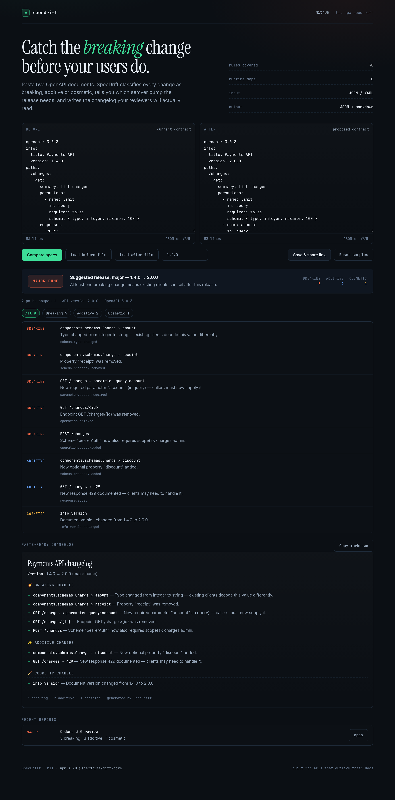
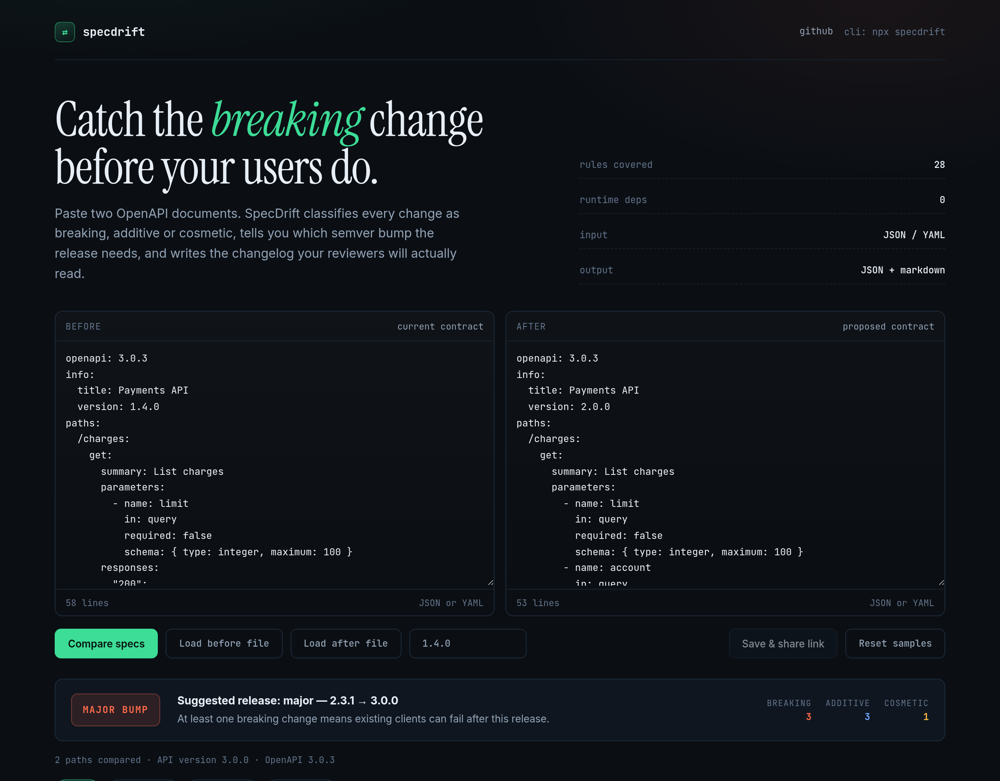
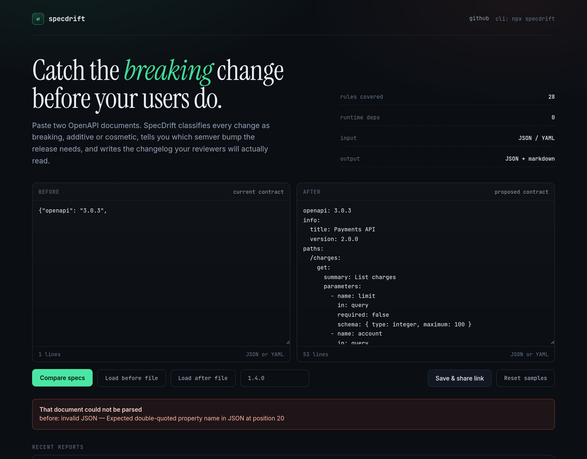

<div align="center">

# SpecDrift

**Find the breaking API change before your users do.**

Diff two OpenAPI documents → every change classified as **breaking**, **additive** or **cosmetic**,
the **semver bump** your release needs, and a **changelog** a reviewer can read in ten seconds.

[](https://github.com/DawoodUrRehman-David/specdrift/actions/workflows/ci.yml)
[](LICENSE)
[](package.json)
[](packages/diff-core/package.json)

</div>

### [▶ Try it in the browser](https://trymuseai.im/apps/cb92c345d2663676/)
Paste two specs, see the verdict. No clone, no install — the engine runs in the tab.



---

## Why

A field quietly changes from `integer` to `string`. A required query parameter appears. An endpoint is
deleted. Your spec says nothing about it, your tests still pass, and three days later a mobile client
starts sending garbage to production.

SpecDrift is the check that runs before that happens:

```console
$ specdrift old.yaml new.yaml

## Payments API changelog

**Version:** 1.4.0 → 2.0.0 (major bump)

### 💥 Breaking changes

- **components.schemas.Charge › amount** — Type changed from integer to string — existing clients decode this value differently.
- **components.schemas.Charge › receipt** — Property "receipt" was removed.
- **GET /charges → parameter query:account** — New required parameter "account" (in query) — callers must now supply it.
- **GET /charges/{id}** — Endpoint GET /charges/{id} was removed.

### ✨ Additive changes

- **components.schemas.Charge › discount** — New optional property "discount" added.
- **GET /charges → 429** — New response 429 documented.

<sub>4 breaking · 2 additive · generated by SpecDrift</sub>

Summary: 6 change(s) — 4 breaking, 2 additive, 0 cosmetic.
Suggested release: major (At least one breaking change means existing clients can fail after this release.)
```

Exit code `1`. Your CI stops. Nobody ships the break.

---

## Three ways to use it

### 1. In CI — one workflow step

```yaml
# .github/workflows/api-contract.yml
name: API contract
on: pull_request

jobs:
  drift:
    runs-on: ubuntu-latest
    steps:
      - uses: actions/checkout@v4
      - uses: DawoodUrRehman-David/specdrift@main
        with:
          before: api/openapi.v2.yaml        # committed on the base branch
          after: api/openapi.yaml            # the proposed spec
          from-version: '2.3.1'
          fail-on: breaking
          comment: 'true'                    # post the changelog on the PR
```

The changelog also lands in the job summary, so the reviewer sees it without opening a log.

### 2. Locally — CLI

```bash
# no install
npx --package @specdrift/diff-core specdrift old.json new.json

# gate a pre-commit hook or a release script
specdrift old.json new.json --fail-on breaking --quiet
echo "exit: $?"     # 1 when something breaks
```

| Flag | Meaning |
| --- | --- |
| `--fail-on <level>` | `breaking` (default), `additive`, `cosmetic`, `none` |
| `--json` | full machine-readable result |
| `--from-version 2.3.1` | compute and print the next version |
| `--quiet` | exit code only, for hooks |

Exit codes: `0` clean · `1` threshold hit · `2` usage or parse error.

### 3. In code

```js
import { diff } from '@specdrift/diff-core';

const result = diff(beforeSpec, afterSpec, { fromVersion: '2.3.1' });

result.summary;    // { total: 6, breaking: 4, additive: 2, cosmetic: 0 }
result.verdict;    // { level: 'major', next: '3.0.0', reason: '…' }
result.changes;    // [{ rule, scope, severity, location, message, before, after }]
result.changelog;  // markdown string
```

Accepts objects, JSON strings, or YAML strings. No parser setup, no `$ref` pre-resolution step.

---

## What counts as breaking

38 rules. The full table is generated from the source, not hand-written, so it cannot drift from behaviour:

| Scope | Breaking | Additive |
| --- | --- | --- |
| **Operation** | endpoint removed, method removed | endpoint added, deprecation flag added |
| **Parameter** | new required param, optional → required, required param removed | new optional param, required → optional, optional param removed |
| **Request body** | body became required, body removed, media type removed | optional body added, media type added |
| **Response** | status removed, media type removed | status added, media type added |
| **Schema** | property removed, required property added, type changed, enum value removed, nullability removed, format changed, constraint tightened, `additionalProperties: false` | optional property added, enum value added, constraint relaxed, required removed |
| **Security** | auth newly required, scheme added, scope added | auth removed, scheme no longer accepted, scope dropped |

Two deliberate design choices:

- **`$ref` is resolved locally before comparison.** Most naive diff tools report "nothing changed"
  when both sides point at the same `#/components/schemas/X` — the pointer is identical, the schema is not.
- **Output is deterministic.** Changes are sorted by severity, location, then rule, so a diff of the same
  pair of documents is byte-identical across runs. Safe to snapshot in tests.

Full rule reference and worked examples: [`docs/rules.md`](docs/rules.md).

---

## The app

A MERN stack around the same engine, for reviewing a spec change with someone who is not in your terminal.

- **React + Vite** explorer: two-pane input, severity filters, semver verdict, formatted changelog with copy button
- **Express + MongoDB** API: stateless diffs plus persisted reports behind short share links (`/r/AbC123xYz9`)
- **Deep links** open a saved report directly — hand a reviewer a URL instead of a spec file

| Share link | Parse error |
| --- | --- |
|  |  |

### Run it

```bash
git clone https://github.com/DawoodUrRehman-David/specdrift.git
cd specdrift
npm install

docker compose up -d mongo     # or point MONGODB_URI at your own
npm run dev                    # API :4000, UI :5173
```

Production build serves the UI from the API on one port:

```bash
npm run build
npm start            # http://localhost:4000
```

Everything in Docker:

```bash
docker compose up --build
```

### API

| Method | Route | Purpose |
| --- | --- | --- |
| `GET` | `/api/health` | service + database state |
| `POST` | `/api/diff` | compare two specs, nothing stored |
| `POST` | `/api/reports` | store a result, get a share slug |
| `GET` | `/api/reports/:slug` | fetch a stored report (increments views) |
| `GET` | `/api/reports?limit=&page=` | recent reports, paginated |

```bash
curl -s localhost:4000/api/diff \
  -H 'content-type: application/json' \
  -d "$(jq -n --rawfile a examples/orders-v2.3.1.json --rawfile b examples/orders-v3.0.0.json \
        '{before:$a, after:$b, fromVersion:"2.3.1"}')" | jq '.data.verdict'
```

Responses are always `{ ok: true, data }` or `{ ok: false, error: { code, message, details? } }`.
Bodies are capped at 8 MB, diff requests are rate limited to 30/min, and validation errors name the
offending field.

---

## Project layout

```
packages/diff-core/     pure JS engine — no framework, no runtime deps, publishable on its own
  src/schema-diff.js    recursive JSON Schema comparison
  src/paths-diff.js     operations, parameters, request bodies, responses, security
  src/semver.js         severity → major/minor/patch verdict
  src/changelog.js      markdown renderer
  bin/specdrift.js      CLI
server/                 Express 4 + Mongoose 8 REST API
client/                 React 18 + Vite explorer
examples/               two real specs that produce a major change
action.yml              composite GitHub Action
```

## Testing

```bash
npm test                              # engine (48) + API (20)
npm run build --workspace client      # production build
```

Engine tests (48) cover every rule with a positive case and a matching negative case that must produce *no*
change, so a rule cannot fire on identical documents. API tests run against a real MongoDB and cover
validation errors, unknown slugs, path traversal attempts, pagination bounds, and view counting.

## Limits (stated on purpose)

- OpenAPI **3.x** is the target. Swagger 2.0 documents parse and mostly work, but 2.0-only structures are not specifically modelled.
- **Document-local `$ref` only.** External URL refs are left unresolved.
- No moving of endpoints between paths, no `webhooks`, no `callbacks`.
- The [hosted demo](https://trymuseai.im/apps/cb92c345d2663676/) runs the engine **in the browser**, so share links
  are disabled there. Run the API locally (two commands above) to persist reports and get `/r/<slug>` links.

## Contributing

Rules are the product. If you know a breaking change this misses, open an issue with both spec
fragments — that is the most valuable contribution. See [CONTRIBUTING.md](CONTRIBUTING.md).

## License

MIT © Dawood Ur Rehman
